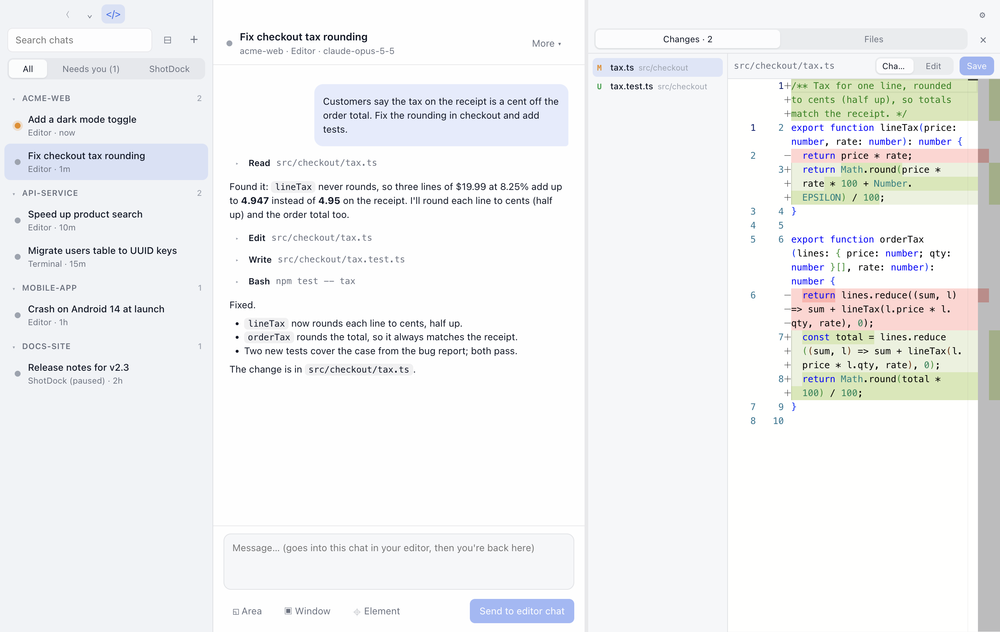
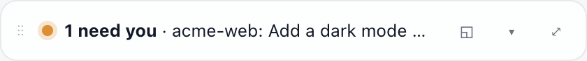
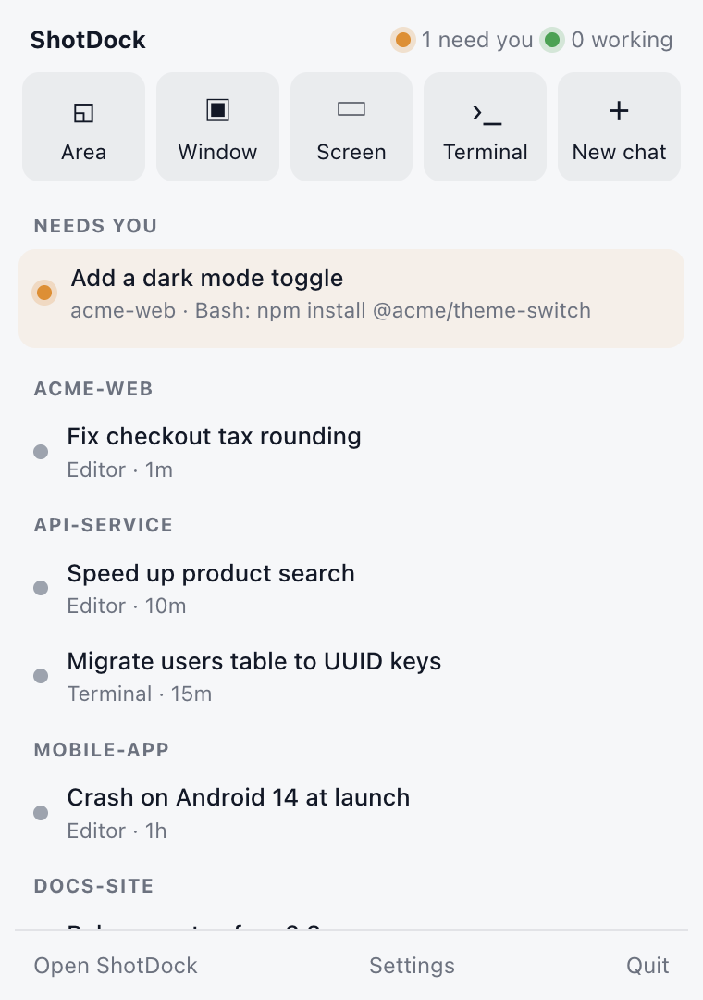

# ShotDock

**One floating window for all your Claude coding chats.** See which chats are working and which are waiting on
you, read any of them, reply, approve tool requests, send screenshots, check what Claude claims it did, and see the
code it changed, without hunting through editor windows and terminals.

Works with Claude Code in **Cursor, VS Code and Windsurf**, Claude Code in the **terminal**, and chats ShotDock
runs itself. Shows **Cursor Agent** chats read-only. macOS now; Windows is in progress.

By **FSE Research and Investments**. MIT licence. Status: **alpha** (2.0.0-alpha). See the [changelog](CHANGELOG.md).

## What you can do

| | |
|---|---|
| **See every chat at once** | Chats from all your projects, grouped by folder, newest first, with a live status dot: green working, orange needs you. |
| **Know what needs you** | When a chat is waiting on a permission or a question (in ShotDock *or* in your editor), it's flagged and counted. |
| **Reply from anywhere** | Type in ShotDock. Chats ShotDock runs get the message directly; editor chats get it in the editor's own chat, then you're back. |
| **Screenshots in one key** | Area, window, whole screen, or the element under the mouse (with its app, page address and text). Pick the chat; mark it up first if you like. |
| **See the code** | The code panel shows what changed in the chat's project as a VS Code diff, and lets you open and edit any file. |
| **Check claims** | One click checks the last answer's claims ("tests pass", "deployed") against what actually ran. |
| **Stay out of the way** | Collapse to a small floating bar, or live in the menu bar. It floats over full-screen apps. |

&nbsp;

## Get started

**Requirements:** macOS 13 or later, and Claude Code set up on your Mac (or an Anthropic API key).

1. Download the latest **ShotDock .dmg** from [Releases](https://github.com/vastdreams/shotdock/releases), open it
   and drag ShotDock to Applications.
2. The alpha isn't notarized yet, so the first time: right-click ShotDock in Applications › **Open** › **Open**.
3. In ShotDock's Settings, allow **Screen recording** (for screenshots) and, if you want element screenshots or
   sending into editor chats, **Accessibility**.

Or build it yourself: see [docs/DEVELOPING.md](docs/DEVELOPING.md).

The full **[User guide](docs/USER_GUIDE.md)** covers every feature, shortcut and setting, plus troubleshooting.

## Privacy and safety

- ShotDock runs on your Mac. It reads Claude Code's local chat files; it has no server and sends nothing anywhere
  except to Claude when you ask it to (sending a message, checking claims).
- It never stores a Claude login. It either uses your existing Claude Code setup or an API key you give it, kept
  encrypted by macOS.
- **One writer per chat.** ShotDock never silently takes over a chat that's open somewhere else. If another app
  writes to a chat ShotDock is running, ShotDock steps back.
- It never types into a chat box that already has your text in it, and puts your clipboard back afterwards.
- The code panel can only open files inside that chat's project folder.

Found a security problem? See [SECURITY.md](SECURITY.md).

## Docs

- [User guide](docs/USER_GUIDE.md): how to use everything (kept up to date with each release)
- [Changelog](CHANGELOG.md)
- [Developing](docs/DEVELOPING.md): build, test, regenerate screenshots, release
- [Architecture](docs/ARCHITECTURE.md): how it's built and why

## ShotDock 1 (legacy)

The original Swift overlay is in [`app/`](app/) with its installer (`install.sh`) and [setup notes](docs/SETUP.md).
It's kept for existing users and will be retired once ShotDock 2 has a notarized release. New work happens in
[`desktop/`](desktop/).
