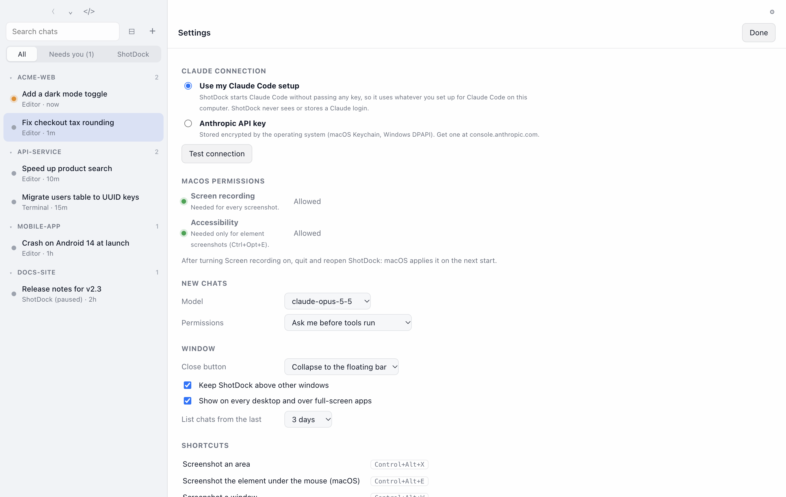
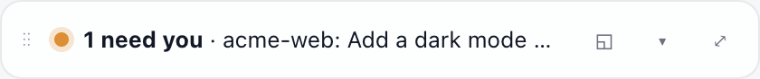
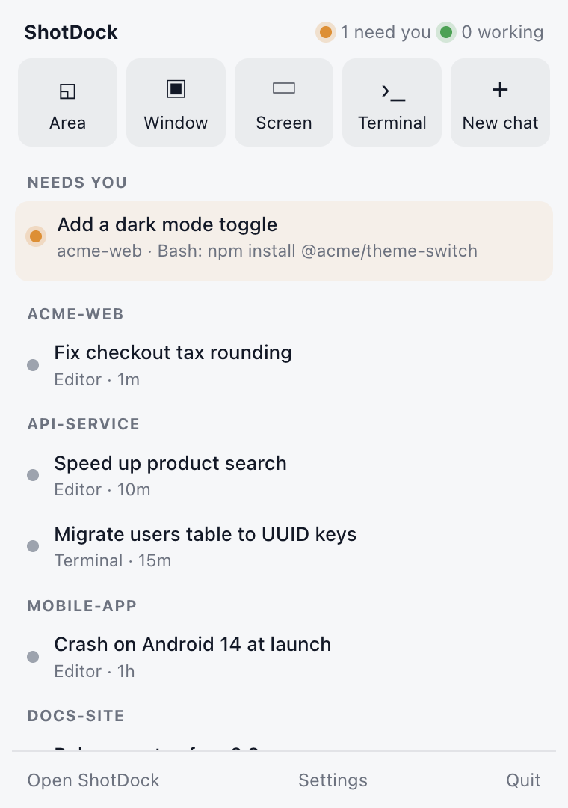
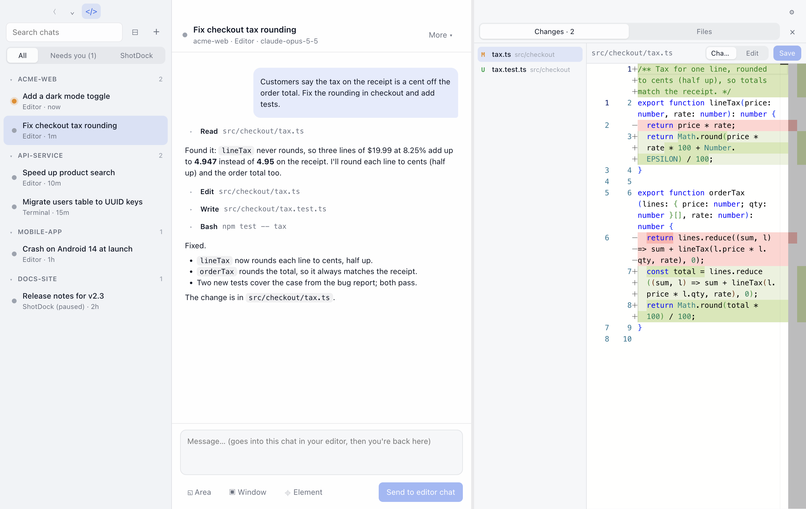
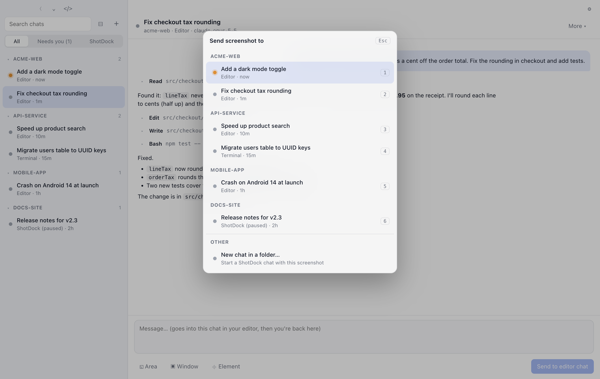

# ShotDock user guide

For ShotDock **2.0.0-alpha**. Last updated **19 November 2026**. This guide is updated with every release; if
something here doesn't match what you see, please [open an issue](https://github.com/vastdreams/shotdock/issues).

**Contents:** [Install](#install) · [First run](#first-run) · [The main window](#the-main-window) ·
[Floating bar and quick panel](#the-floating-bar-and-the-quick-panel) · [Sending messages](#sending-messages) ·
[Needs you](#needs-you) · [Screenshots](#screenshots) · [Code panel](#the-code-panel) ·
[Checking claims](#checking-claims) · [Terminal](#terminal) · [Settings](#settings) ·
[Shortcuts](#keyboard-shortcuts) · [Troubleshooting](#troubleshooting) · [FAQ](#faq)

---

## Install

1. Download **ShotDock-*version*.dmg** from [Releases](https://github.com/vastdreams/shotdock/releases).
2. Open it and drag **ShotDock** into **Applications**.
3. First launch only: right-click ShotDock › **Open** › **Open**. (The alpha isn't notarized by Apple yet, so a
   normal double-click is refused the first time.)

To build from source instead, see [DEVELOPING.md](DEVELOPING.md).

## First run

ShotDock opens its main window and puts an icon in the menu bar.

**1. Connect Claude.** Settings (⚙ top right) › *Claude connection*:

- **Use my Claude Code setup** (default): ShotDock starts Claude Code without passing any key, so it uses whatever
  you set up for Claude Code on this Mac. ShotDock never sees or stores a Claude login.
- **Anthropic API key**: paste a key from console.anthropic.com. It's stored encrypted by macOS.

Press **Test connection**: you should see the model name and a time.

**2. Allow permissions** (Settings › *macOS permissions*):

| Permission | Needed for | |
|---|---|---|
| Screen recording | Every screenshot | Press **Allow…**, switch ShotDock on, then quit and reopen ShotDock |
| Accessibility | Element screenshots, and sending into chats that are open in your editor | Press **Allow…** and switch ShotDock on |

## The main window

- **Left:** every chat from the last few days, grouped by project folder, newest first. Search at the top;
  filter **All / Needs you / ShotDock**. Click a folder name to fold it; **⊟** folds them all.
- **Middle:** the open chat. Tool calls (commands, file reads and edits) are one line each; click to see the output.
- **Bottom:** the message box. Drop or paste images into it.
- **Top left:** **☰ / ⟨** shows or hides the chat list (⌘\\), **⌄** collapses to the floating bar, **</>** opens the
  code panel (⌘E).

The window shrinks down to 360 px wide; below 760 px the chat list hides itself.

**Who runs each chat** (shown under its title):

| Label | Meaning |
|---|---|
| Editor | Claude Code in Cursor, VS Code or Windsurf |
| Terminal | Claude Code in a terminal |
| ShotDock | A chat ShotDock is running right now |
| ShotDock (paused) | A chat ShotDock ran before it restarted; sending resumes it |
| Cursor Agent | Cursor's own agent; read-only in ShotDock |

**Status dots:** green = working, orange = needs you, grey = idle, red = failed.

## The floating bar and the quick panel

**Floating bar.** Press **⌄** (or the window's close button) and the window becomes a short bar that floats above
everything, including full-screen apps. Drag it anywhere.

- Click the text: opens the chat that needs you most (or the window).
- **◱** screenshot · **▾** quick panel · **⤢** back to the full window.

**Quick panel.** Click the menu bar icon (or press **Ctrl+Opt+D**). It shows counts, quick screenshot buttons,
**Terminal**, **New chat**, chats that need you (with **Allow / Deny** for ShotDock chats) and recent chats.
Right-click the menu bar icon for the full menu, including **Open at login** and **Quit**.

> If you can't see the menu bar icon, macOS has hidden it (too many icons, or behind the camera notch). Use
> **Ctrl+Opt+D**, remove a few other icons, or allow ShotDock in System Settings › Menu Bar.

## Sending messages

Type in the message box and press **Enter** (Shift+Enter for a new line). What happens depends on the chat:

| Chat | What Send does |
|---|---|
| **ShotDock** | Goes straight to Claude. You can **Stop** it, **Allow / Deny** tool requests, and switch the **model**. |
| **ShotDock (paused)** | Resumes the chat in ShotDock, then sends. |
| **Editor** | **Send to editor chat**: ShotDock brings that chat forward in your editor, puts your message (and screenshots) in its box, presses Enter, and brings you back. It refuses if you have unsent text in that box. Needs Accessibility. |
| **Terminal** | Asks first: close it in the terminal and continue in ShotDock, or copy it into a new ShotDock chat. |
| **Cursor Agent** | Read-only. Cursor doesn't let other apps send to its agent. |

**More ▾** in a chat's header has the rest: *Check claims*, *Continue in Terminal*, *Open in editor* (or *Send back
to editor* for chats ShotDock runs), and for editor chats *Run this chat in ShotDock instead* or *Copy to a new
ShotDock chat*.

**One writer per chat.** ShotDock never runs a chat that's also open in another app. If the editor or a terminal
writes to a chat ShotDock is running, ShotDock stops its side and tells you.

**New chat:** **＋** next to the search box (or *New chat* in the quick panel), then pick a project folder.

## Needs you

A chat **needs you** when Claude is waiting on a permission or a question.

- **ShotDock chats:** an orange bar shows the request with **Allow**, **Always allow** (for this chat) and **Deny**.
  You also get a notification.
- **Editor and terminal chats:** ShotDock reads their chat file and flags a request that hasn't been answered for a
  few seconds (questions right away). Answer it in the editor; **Answer in editor** takes you there.

Which tools ask depends on your Claude Code permission settings; ShotDock follows the same rules.

## Screenshots

| Shortcut | Captures |
|---|---|
| **Ctrl+Opt+X** | An area you drag |
| **Ctrl+Opt+W** | A window you click |
| **Ctrl+Opt+E** | The element under the mouse, plus its app, window, page address and text |
| Quick panel › Screen | The whole screen |

After a capture, **Send screenshot to** lists your chats by project. Pick one with the mouse, ↑ ↓ and Return, or
1-9. Esc keeps the screenshot attached so you can pick later.

The screenshot appears as a thumbnail in that chat's message box. **Click it to mark it up:** Box, Arrow, Text,
Blur (pixelates, so it can't be reversed). Add your message and send.

## The code panel

Press **</>** or **⌘E** to open VS Code's editor beside the chat. Drag the divider to resize.

- **Changes:** files changed in the chat's project since the last commit (git): **M** modified, **A** added,
  **U** new, **D** deleted. Click one to see the diff with highlights; switch between **Changes** and **Edit**.
- **Files:** find and open any file in the project.
- Edit and **Save** (⌘S). The open file updates as Claude edits it (unless you have unsaved changes).

It can only open text files inside the chat's project folder. Code completion and extensions aren't included.

## Checking claims

**More ▾ › Check claims** asks Claude to compare the last answer with what actually ran in that turn. Each claim is
marked *supported*, *unsupported* or *unclear*, with the reason. If something isn't backed up, you get a suggested
follow-up to copy into the message box. Nothing is sent for you.

## Terminal

- **More ▾ › Continue in Terminal** opens Terminal with that chat resumed in Claude Code.
- **Quick panel › Terminal** starts Claude Code in a folder you pick.

ShotDock includes Claude Code, so nothing else needs installing.

## Settings

| Setting | |
|---|---|
| Claude connection | Your Claude Code setup, or an API key. Test connection. |
| macOS permissions | Status and **Allow…** buttons |
| New chats | Default model; whether tools ask first, file edits are allowed, or plan only |
| Close button | Collapse to the floating bar (default) or hide to the menu bar |
| Keep above other windows / Show on every desktop | Floating behaviour |
| List chats from the last | 1 to 30 days |

## Keyboard shortcuts

| Keys | |
|---|---|
| Ctrl+Opt+Space | Show or hide ShotDock |
| Ctrl+Opt+D | Quick panel |
| Ctrl+Opt+X / W / E | Screenshot: area / window / element |
| ⌘\\ | Show or hide the chat list |
| ⌘E | Code panel |
| ⌘S | Save in the code panel |
| Enter / Shift+Enter | Send / new line |
| ↑ ↓ Return, 1-9, Esc | In "Send screenshot to" |

## Troubleshooting

| Problem | Fix |
|---|---|
| "Could not create image from display" / screenshots fail | Settings › macOS permissions › Screen recording › **Allow…**, then quit and reopen ShotDock. |
| Element screenshots or *Send to editor chat* fail | Allow **Accessibility** for ShotDock. |
| "You have unsent text in that chat's box" | Send or clear the draft in the editor, then send again. |
| A shortcut does nothing | Another app has it. Quit the other app (for example ShotDock 1). |
| No menu bar icon | See the note under [Quick panel](#the-floating-bar-and-the-quick-panel); use Ctrl+Opt+D. |
| "Run ended" / connection errors | Settings › Test connection. With "Use my Claude Code setup", make sure Claude Code works in a terminal. |
| A chat is missing | Settings › *List chats from the last*: increase the days. |

Logs: `~/Library/Application Support/ShotDock/logs/shotdock.log` (keys and emails are removed before writing).
Attach the last lines when you report a bug.

## FAQ

**Does ShotDock send my code anywhere?** Only to Claude, when you send a message or check claims, through your own
Claude Code setup or API key. ShotDock has no server.

**Can I log in with my Claude account in ShotDock?** No. Anthropic doesn't allow third-party apps to offer
claude.ai login. Use your Claude Code setup (which you log in to yourself) or an API key.

**Why does sending to an editor chat switch to the editor for a moment?** The Claude Code extension doesn't accept
messages from other apps for a chat that's open, so ShotDock types it into the editor's chat box for you, the same
way you would, then comes back.

**Windows?** The app is built for both; the Windows version hasn't been tested yet and has no element screenshots
or editor sending.
